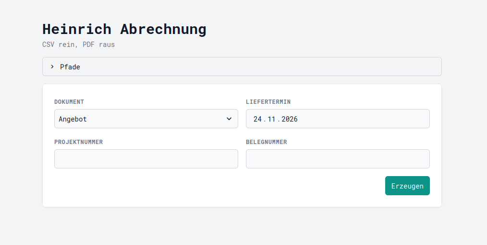

# Automatisierung des Rechnungsprozesses für Heinrich Metallbau

Dieses Tool wird für Heinrich Metallbau entwickelt, um die manuelle Erstellung von Angeboten, Lieferscheinen, Auftragsbestätigungen und Rechnungen zu automatisieren. Perspektivisch ist auch die Erstellung von E-Rechnungen geplant. Es ist aktuell als lokale Streamlit-Webapp sowie als CLI-Tool nutzbar. Grundlage sind CSV-Exporte aus der bestehenden Zeiterfassungssoftware des Kunden, die automatisch verarbeitet und in ein vorhandenes Word-Template übertragen werden. Statt den Betrieb an eine Standardsoftware anzupassen, passt sich das Tool an dessen bestehende Geschäftsprozesse an.

> **Warum ist das öffentlich?** Heinrich Metallbau hat freundlicherweise der Nutzung als Portfolio-Projekt zugestimmt. Sensible Daten liegen nicht im Repo.

---

Die Benutzeroberfläche ist bisher bewusst einfach gehalten: Dokument wählen, Liefertermin und Projektnummer eintragen, erzeugen.




---

## 1. Installation und Updates (Windows)

Installation und Updates übernimmt ein Skript. Vorkenntnisse oder vorinstallierte Programme sind nicht nötig.

### Ersteinrichtung

1. **PowerShell** öffnen (Startmenü → „PowerShell“ eingeben).
2. Folgende Zeile einfügen und mit Enter bestätigen:

```
(irm https://raw.githubusercontent.com/marypaulin/heinrich-tool/main/scripts/setup.ps1).TrimStart([char]0xFEFF) | iex
```

> **Wichtig:** Als Installationsort einen lokalen Ordner wählen, nicht OneDrive.

Das Skript

* installiert Git und uv, falls sie fehlen,
* fragt per Dialog nach dem Installationsort und legt dort den Ordner `heinrich-tool` an,
* lädt das Tool herunter und richtet Python samt Bibliotheken ein,
* legt die Verknüpfungen **Heinrich Tool** (Desktop und Startmenü) und **Heinrich Tool aktualisieren** (Startmenü) an.

### Updates

1. Startmenü → **Heinrich Tool aktualisieren** öffnen (alternativ `update.bat` im Projektordner).
2. Das Fenster zeigt den Fortschritt und wartet am Ende auf einen Tastendruck.

Wurden Dateien im Ordner `heinrich-tool` von Hand bearbeitet, bricht das Update ab und lässt alles unverändert.

---

## 2. Konfiguration


Für die Nutzung des Tools werden zwei weitere Dateien benötigt, die sich nicht im Repository befinden:

- `Vordruck.docx` (Word-Template für alle Outputdokumente)
- `config.json` (Konfigurationsdatei mit den Bezeichnungen der Stundensätze, dem Mehrwertsteuersatz sowie Texten und Dateinamen der Dokumente)

Diese enthalten Geschäftsdaten des Kunden und liegen in seinem OneDrive, damit sie auf allen Geräten synchron sind.

Beim ersten Start ist der Block **Pfade** oben auf der Hauptseite geöffnet, die Dokumente sind bis dahin gesperrt. Dort einmal pro Rechner eintragen und **Speichern**:

- **Datenordner:** der Ordner mit den Projektordnern
- **Config:** Pfad zur `config.json`
- **Vordruck:** Pfad zur `Vordruck.docx`

Die Pfade lassen sich im Explorer per Rechtsklick → **Als Pfad kopieren** übernehmen, die Anführungszeichen dürfen stehen bleiben. Gespeichert werden sie in `%LOCALAPPDATA%\HeinrichTool\settings.json`, nur für diesen Rechner.

---

## 3. Nutzung als App (Windows)

Das Tool läuft als lokale Web-App und wird per Doppelklick auf die Verknüpfung **Heinrich Tool** gestartet.

* Die App öffnet sich automatisch im Standardbrowser.
* Ist die App bereits geöffnet, wird lediglich ein weiterer Browser-Tab geöffnet.

Im Formular **Dokument** wählen, **Liefertermin** setzen (vorbelegt mit heute), **Projektnummer** und bei Bedarf **Belegnummer** eintragen, dann **Erzeugen**. Die Eingaben bleiben stehen, bis sie geändert werden, so lassen sich etwa Angebot und Lieferschein direkt nacheinander erzeugen.

---

## 4. Nutzung als CLI-Tool

Als CLI-Tool wird das Programm im Projektordner über die Kommandozeile gestartet. Es braucht [uv](https://docs.astral.sh/uv/) — nach der Installation aus Abschnitt 1 ist alles eingerichtet. Ansonsten das Repository klonen und einmalig im Projektordner `uv sync` ausführen.

Das CLI nutzt die in der App gespeicherten Pfade (Abschnitt 2). Sind dort noch keine eingetragen, bricht es mit einem Hinweis ab.

```
uv run python -m heinrich_tool.cli -m MODUS -p PROJEKTNUMMER [-r BELEGNUMMER] [-d JJJJ-MM-TT]
```

| Option | Bedeutung |
|---|---|
| `-m`, `--mode` | `offer`, `delivery_note`, `invoice` oder `order_confirmation` |
| `-p`, `--project-number` | vierstellige Projektnummer |
| `-r`, `--receipt-number` | Belegnummer, je nach Dokument (siehe Abschnitt 5) |
| `-d`, `--delivery-date` | Liefertermin, ohne Angabe heute |

Beispiele:

```
uv run python -m heinrich_tool.cli -m offer -p 1408
uv run python -m heinrich_tool.cli -m invoice -p 1408 -r 8100045372 -d 2026-12-01
```

Alle Optionen zeigt `--help`.

---

## 5. Dokumenten-Workflows

Jeder Durchgang erzeugt genau ein Dokument, direkt aus der Zeiterfassungs-CSV des Projekts und unabhängig davon, ob für das Projekt schon andere Dokumente erzeugt wurden.

**Gemeinsamer Ablauf je Dokument**

1. Die CSV-Datei des Projekts wird eingelesen (neueste Datei).
2. Die CSV-Zeilen werden in strukturierte Positionen (Line Items) umgewandelt.
3. Die originale Word-Vorlage (`Vordruck.docx`) wird geladen.
4. Die Positionstabelle wird mit den Line Items befüllt.
5. Die Platzhalter werden gesetzt (Summen, Liefertermin, Datum, Nummern, Dokumenttyp). Fehlt einer davon im Vordruck, bricht die Erzeugung mit einer Meldung ab.
6. Das Dokument wird als DOCX gespeichert.
7. Zusätzlich wird eine PDF-Version erzeugt.

---

### Eingaben und Ergebnisse

Jedes Dokument braucht die Projektnummer, den Liefertermin und die Zeiterfassungs-CSV im Projektordner (automatisch erkannt anhand der Projektnummer). Die Belegnummer hängt vom Dokument ab:

| Dokument | Modus (CLI) | Belegnummer | Datei |
|---|---|---|---|
| Angebot | `offer` | entfällt, eine angegebene wird mit Warnung ignoriert | `Angebot Nr. <project_number>.docx/.pdf` |
| Lieferschein | `delivery_note` | optional | `Lieferschein Nr. <project_number>.docx/.pdf` |
| Rechnung | `invoice` | Pflicht | `Rechnung Nr. <project_number> - <receipt_number>.docx/.pdf` |
| Auftragsbestätigung | `order_confirmation` | Pflicht | `Auftragsbestätigung Nr. <project_number> - <receipt_number>.docx/.pdf` |

---

## 6. Geplante Erweiterungen

Folgende Erweiterungen sind geplant:

* Übersicht aller erfassten Stunden über alle Projekte hinweg, als CSV exportierbar
* Erzeugung von E-Rechnungen im Format ZUGFeRD

---

## 7. Testing

Die Tests liegen unter `tests/` und laufen mit pytest:

```
uv run pytest
```

Manuelle Testfälle für Setup-Skript und Windows-VM stehen in [`docs/testing.md`](docs/testing.md); das PDF-Rendering wird von Hand geprüft.
