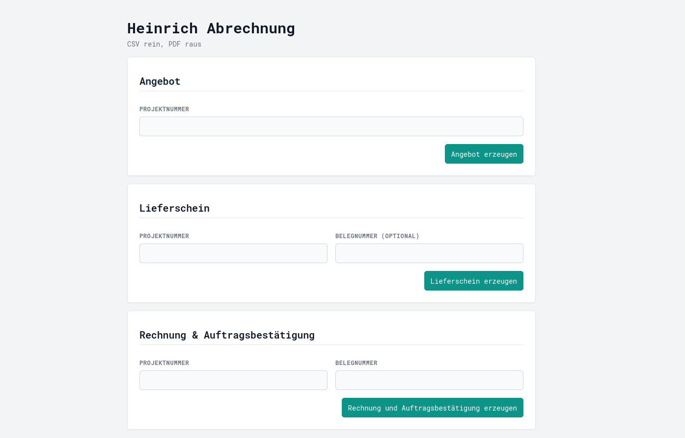

# Automatisierung des Rechnungsprozesses für Heinrich Metallbau

Dieses Tool wird für Heinrich Metallbau entwickelt, um die manuelle Erstellung von Angeboten, Lieferscheinen, Auftragsbestätigungen und Rechnungen zu automatisieren. Perspektivisch ist auch die Erstellung von E-Rechnungen geplant. Es ist aktuell als lokale Streamlit-Webapp sowie als CLI-Tool nutzbar. Grundlage sind CSV-Exporte aus der bestehenden Zeiterfassungssoftware des Kunden, die automatisch verarbeitet und in ein vorhandenes Word-Template übertragen werden.

> **Warum ist das öffentlich?** Heinrich Metallbau hat freundlicherweise zugestimmt, dass ich das Projekt als Portfolio-Beispiel zeigen darf. Sensible Daten liegen nicht im Repo.

---

Die Benutzeroberfläche ist bisher bewusst einfach gehalten: Projektnummer eingeben, Dokument erzeugen.




---

## 1. Installation und Updates (Windows)

Installation und Updates übernimmt ein Skript. Vorkenntnisse oder vorinstallierte Programme sind nicht nötig.

### Ersteinrichtung

1. **PowerShell** öffnen (Startmenü → „PowerShell“ eingeben).
2. Folgende Zeile einfügen und mit Enter bestätigen:

```
irm https://raw.githubusercontent.com/marypaulin/heinrich-tool/main/scripts/setup.ps1 | iex
```

> **Wichtig:** Als Installationsort einen lokalen Ordner wählen, nicht in OneDrive.

Das Skript

* installiert Git und uv, falls sie fehlen,
* fragt per Dialog nach dem Installationsort und legt dort den Ordner `heinrich-tool` an,
* lädt das Tool herunter und richtet Python samt Bibliotheken ein,
* legt die Verknüpfungen **Heinrich Tool** (Desktop und Startmenü) und **Heinrich Tool aktualisieren** (Startmenü) an.

### Updates

1. Startmenü → **Heinrich Tool aktualisieren** öffnen (alternativ `update.bat` im Projektordner).
2. Das Fenster zeigt den Fortschritt und wartet am Ende auf einen Tastendruck.

Wurden Dateien im Ordner `heinrich-tool` von Hand bearbeitet, bricht das Update ab und lässt alles unverändert.

---

## 2. Konfiguration


Für die Nutzung des Tools werden zwei weitere Dateien benötigt, die sich nicht im Repository befinden:

- `Vordruck.docx` (Word-Template für alle Outputdokumente)
- `config.json` (Konfigurationsdatei mit Stundenlohn, Mehrwertsteuersatz etc.)

Diese erhält der Nutzer des Tools per Mail. Für die korrekte Nutzung:

1. `Vordruck.docx` → Ordner `templates`
2. `config.json` → Heinrich Tool Projektordner (Root-Ebene)
3. In `config.json` den Pfad zum Datenverzeichnis konfigurieren: `"DATA_ROOT": "/Pfad/zum/Datenordner/"`

---

## 3. Nutzung als App (Windows)

Das Tool läuft als lokale Web-App und wird per Doppelklick auf die Verknüpfung **Heinrich Tool** gestartet.

* Die App öffnet sich automatisch im Standardbrowser.
* Ist die App bereits geöffnet, wird lediglich ein weiterer Browser-Tab geöffnet.

---

## 4. Nutzung als CLI-Tool

Als CLI-Tool wird das Programm im Projektordner über die Kommandozeile gestartet. Es braucht [uv](https://docs.astral.sh/uv/) — nach der Installation aus Abschnitt 1 ist alles eingerichtet. Ansonsten das Repository klonen und einmalig im Projektordner `uv sync` ausführen.

### Angebot erzeugen

```
uv run python cli.py --mode offer --project-number 1408
```
oder kurz
```
uv run python cli.py -m offer -p 1408
```

---

### Lieferschein erzeugen

```
uv run python cli.py --mode delivery --project-number 1408
```
oder kurz
```
uv run python cli.py -m delivery -p 1408
```
oder mit optionaler Belegnummer
```
uv run python cli.py -m delivery -p 1408 -r 8100045372
```


---

### Rechnung & Auftragsbestätigung erzeugen

```
uv run python cli.py --mode invoice --project-number 1408 --receipt-number 8100045372
```
oder kurz
```
uv run python cli.py -m invoice -p 1408 -r 8100045372
```

---

## 5. Dokumenten-Workflows

Das Tool arbeitet mit klar getrennten Modi. Jeder Modus erzeugt seine Dokumente direkt aus der Zeiterfassungs-CSV des Projekts, unabhängig davon, ob für das Projekt schon andere Dokumente erzeugt wurden.

**Gemeinsamer Ablauf je Dokument**

1. Die CSV-Datei des Projekts wird eingelesen (neueste Datei).
2. Die CSV-Zeilen werden in strukturierte Positionen (Line Items) umgewandelt.
3. Die originale Word-Vorlage (`Vordruck.docx`) wird geladen.
4. Die Positionstabelle wird mit den Line Items befüllt.
5. Die Platzhalter werden gesetzt (Summen, Liefertermin, Datum, Nummern, Dokumenttyp).
6. Das Dokument wird als DOCX gespeichert.
7. Zusätzlich wird eine PDF-Version erzeugt.

---

### Modus `offer` oder `delivery` – Angebot oder Lieferschein erzeugen

**Eingaben**

* `project_number`
* Optional: `receipt_number` (für delivery mode)
* Zeiterfassungs-CSV im Projektordner (automatisch erkannt anhand `project_number`)

**Ergebnisse**

* `Angebot/Lieferschein Nr. <project_number>.docx`
* `Angebot/Lieferschein Nr. <project_number>.pdf`

---

### Modus `invoice` – Rechnung und Auftragsbestätigung erzeugen

**Eingaben**

* `project_number`
* `receipt_number`
* Zeiterfassungs-CSV im Projektordner (automatisch erkannt anhand `project_number`)

Der gemeinsame Ablauf läuft zweimal, einmal für die Rechnung und einmal für die Auftragsbestätigung.

**Ergebnisse**

* `Rechnung Nr. <project_number> - <receipt_number>.docx`
* `Rechnung Nr. <project_number> - <receipt_number>.pdf`
* `Auftragsbestätigung Nr. <project_number> - <receipt_number>.docx`
* `Auftragsbestätigung Nr. <project_number> - <receipt_number>.pdf`

---

## 6. Geplante Erweiterungen

Folgende Erweiterungen sind geplant:

* Übersicht aller erfassten Stunden über alle Projekte hinweg, als CSV exportierbar
* Erzeugung von E-Rechnungen im Format ZUGFeRD

---

## 7. Testing

Die Tests liegen unter `tests/` und laufen mit pytest:

```
uv run pytest
```

Die Abdeckung wächst modulweise mit; das PDF-Rendering wird weiterhin manuell geprüft.
